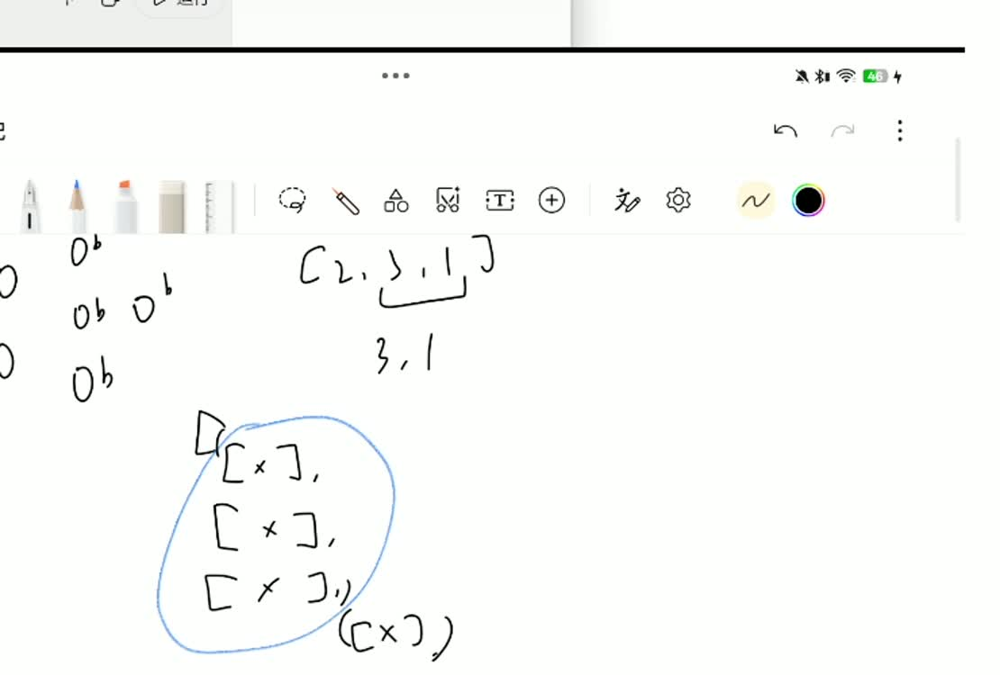
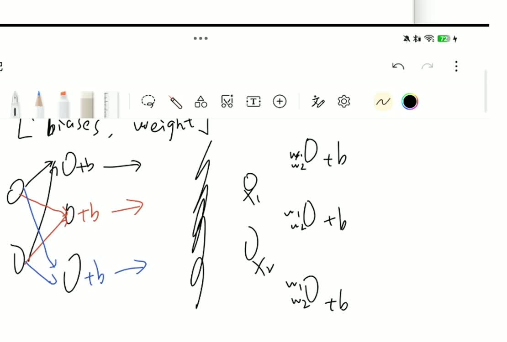

# 从 Network 到 SGD：两次神经网络学习录屏笔记

> 根据 `20261007-231328.mp4`（55 分 19 秒）和 `20261011-171723.mp4`（60 分 44 秒）整理。视频是自学过程，包含提问、尝试和中途误解。下文按知识顺序重组，并将画面中的误解明确更正；数值演算属于整理者补充，不冒充视频原话。时间点用于回看本地视频。

课程来源：Michael Nielsen《Neural Networks and Deep Learning》，第 1.7 节 [Implementing our network to classify digits](https://eng.libretexts.org/Bookshelves/Computer_Science/Applied_Programming/Neural_Networks_and_Deep_Learning_(Nielsen)/01%3A_Using_neural_nets_to_recognize_handwritten_digits/1.07%3A_Implementing_our_network_to_classify_digits)，第 1.8 节 [Toward deep learning](https://eng.libretexts.org/Bookshelves/Computer_Science/Applied_Programming/Neural_Networks_and_Deep_Learning_(Nielsen)/01%3A_Using_neural_nets_to_recognize_handwritten_digits/1.08%3A_Toward_deep_learning)。

## 1. 两个视频连接起来讲了什么

第一段解决“网络怎样保存和计算”，第二段解决“网络怎样学习”。

```text
创建网络 → 保存每层的权重和偏置
输入图片 → 前向传播 → 得到预测
预测与正确答案比较 → 计算损失
反向传播 → 算出每个参数的梯度
小批次内累加、取平均 → 更新参数
重复多轮 → 用测试集检查识别效果
```

不要把“计算预测”和“训练网络”混为一谈。`feedforward` 只计算输出；参数更新发生在 `update_mini_batch` 的最后两行。

## 2. Network([2, 3, 1])：数字描述的是层大小

**第一段约 01:20–20:45。** 这个列表表示输入层 2 个神经元、隐藏层 3 个、输出层 1 个，共三层。

```python
import random
import numpy as np

class Network(object):
    def __init__(self, sizes):
        self.num_layers = len(sizes)
        self.sizes = sizes
        self.biases = [np.random.randn(y, 1) for y in sizes[1:]]
        self.weights = [np.random.randn(y, x)
                        for x, y in zip(sizes[:-1], sizes[1:])]
```

`self` 代表当前网络对象。`self.sizes` 是对象保存的属性，`sizes` 是传入的参数。输入层只接收数据，本节实现不给它配置偏置。

| 表达式 | 对 [2, 3, 1] 的结果 |
|---|---|
| `len(sizes)` | 3 |
| `sizes[1:]` | [3, 1] |
| `sizes[:-1]` | [2, 3] |
| `list(zip(sizes[:-1], sizes[1:]))` | [(2, 3), (3, 1)] |

`np.random.randn(y, x)` 创建 y 行、x 列的标准正态随机数组。Python 3 的 `zip` 返回迭代器，用 `list(...)` 才能直接展示配对后的列表。



## 3. biases 和 weights 实际存了什么

它们都是列表，列表中的每个元素是一个 NumPy 数组。严格说是 `ndarray`，书里把表示数学矩阵的二维数组称作 matrix，不代表使用了 `np.matrix` 类型。

以下都是用于说明结构的假数字：

```python
biases = [
    np.array([[0.1], [0.2], [0.3]]),  # 隐藏层：3×1
    np.array([[0.4]])                 # 输出层：1×1
]
weights = [
    np.array([[0.1, 0.2],             # 输入层→隐藏层：3×2
              [0.3, 0.4],
              [0.5, 0.6]]),
    np.array([[0.7, 0.8, 0.9]])       # 隐藏层→输出层：1×3
]
```

权重矩阵的**每一行对应一个接收方神经元，每一列对应一个来源神经元**。2 个输入连接到 3 个隐藏神经元，共 6 条连接，存成 3×2，不是 2×3。

数学下标 `w[j,k]` 的意思是：从前一层第 k 个神经元，到后一层第 j 个神经元的权重。`weights[0]` 对应第一组层间连接，`weights[1]` 对应第二组。


**视频更正：** 录屏中曾按“每个输入保存自己发出的三个权重”画成两行三列。这种连接视角可以理解网络，但不符合原文实际数组布局。代码 `randn(y, x)` 和后面的矩阵乘法确定了正确形状。

## 4. z 与 sigmoid 是两步

**第一段约 22:00–36:45。** 单个 sigmoid 神经元计算：

$$z=\sum_k w_k x_k+b,\qquad a=\sigma(z)=\frac{1}{1+e^{-z}}.$$

`z` 是加权和**加上偏置**，`a` 才是激活函数后的输出。小写 σ 表示 sigmoid，Σ / ∑ 表示求和，两者不是同一个符号。

```python
def sigmoid(z):
    return 1.0 / (1.0 + np.exp(-z))
```

为什么只有一个参数？因为输入、权重和偏置已经在外面算成了 z；这个函数只做最后的非线性转换。z 是数组时，NumPy 对各元素分别计算。

视频中的一个算例可整理为：输入 (1, 0.5)，权重 (0.8, −0.2)，偏置 0.4，则加权和是 0.7，z=1.1，σ(z)≈0.7503。

**补充区别：** 感知器根据阈值给出 0/1；sigmoid 神经元给出连续的激活值。阈值 θ 可以通过 b=−θ 写进加权输入，但“阈值”和“偏置”的数值并不直接相等。


## 5. feedforward：逐层计算，a 被覆盖

**第一段约 36:45–55:19。**

```python
def feedforward(self, a):
    for b, w in zip(self.biases, self.weights):
        a = sigmoid(np.dot(w, a) + b)
    return a
```

`zip` 配的是整张偏置数组和整张权重数组，不是它们内部的数字。第一轮取 `biases[0]`、`weights[0]`，第二轮取各自下标 1 的元素。

**乘的是 w 与 a，不是 w 与 b。** 执行顺序是先算 `np.dot(w, a)`，再加 b，最后算 sigmoid。

| 循环 | w | 旧 a | b | 新 a |
|---|---|---|---|---|
| 第一轮 | 3×2 | 2×1 输入 | 3×1 | 3×1 隐藏层输出 |
| 第二轮 | 1×3 | 3×1 隐藏层输出 | 1×1 | 1×1 最终输出 |

用上一节假参数和输入 a=[[1],[2]]，第一次矩阵乘法：

```text
0.1×1 + 0.2×2 = 0.5
0.3×1 + 0.4×2 = 1.1
0.5×1 + 0.6×2 = 1.7
```

加偏置得到 z=[0.6,1.3,2.0]ᵀ，sigmoid 后约为 [0.645656,0.785835,0.880797]ᵀ。第二轮 z≈0.7×0.645656+0.8×0.785835+0.9×0.880797+0.4=2.273345，最终输出约为 [[0.906645]]。

**更正与补充：** `a = ...` 是赋值，a 每轮被下一层输出覆盖，不是在累加。输入应为 `(n,1)` 列向量；返回的是输出数组，输出层有一个神经元时也是 `(1,1)`。单个随机输出不自动等于可靠概率或分类答案。



## 6. SGD：安排每一轮训练

**第二段约 00:30–19:30。** SGD 在这里是小批次随机梯度下降。`epochs` 是学习完整训练集的轮数，`mini_batch_size` 是每批样本数，`eta` 是学习率。

```python
def SGD(self, training_data, epochs, mini_batch_size, eta,
        test_data=None):
    if test_data:
        n_test = len(test_data)
    n = len(training_data)
    for j in range(epochs):
        random.shuffle(training_data)
        mini_batches = [
            training_data[k:k+mini_batch_size]
            for k in range(0, n, mini_batch_size)
        ]
        for mini_batch in mini_batches:
            self.update_mini_batch(mini_batch, eta)
        if test_data:
            print("Epoch {0}: {1} / {2}".format(
                j, self.evaluate(test_data), n_test))
        else:
            print("Epoch {0} complete".format(j))
```

上面保留原文算法，改用 Python 3 的 `range` 和 `print(...)`。

以 6 个样本、每批 2 个为例，`range(0,6,2)` 产生起点 0、2、4，切片得到 `training_data[0:2]`、`[2:4]`、`[4:6]`。切片不包含结束位置。最后一批不足指定大小也会保留。

每轮先打乱**样本的顺序**，图片和对应答案不会被拆散；处理完这一轮的全部批次后才评估。`Epoch 0` 是第一轮结束，不是尚未训练。

**视频更正：** 录屏口述多次使用“6 万张训练数据”。本节实际把官方 60,000 张训练图片分成 50,000 张用于训练和 10,000 张用于验证，另有 10,000 张测试图。每批 10 个时，本节一轮更新 5,000 次，而不是一次。

## 7. mini_batch 中的 x 和 y 从哪里来

**第二段约 26:00–29:30。** `training_data` 原本就是样本对的列表：

```python
training_data = [(图片A, 答案A), (图片B, 答案B),
                 (图片C, 答案C), (图片D, 答案D)]
mini_batches = [
    [(图片A, 答案A), (图片B, 答案B)],
    [(图片C, 答案C), (图片D, 答案D)]
]
```

这里只是结构示意，不是直接可运行的图片变量。分批没有改变样本结构，所以 `for x, y in mini_batch` 每次取出一个二元组，并把图片交给 x、答案交给 y。

在 MNIST 中，x 是 `(784,1)` 的像素列向量，训练用 y 是 `(10,1)` 的答案向量。数字 2 的标签对应 `[0,0,1,0,0,0,0,0,0,0]ᵀ；测试集标签则是整数 2。这两种格式在 `mnist_loader` 中有意区别。

给图片确定正确标签叫标注；已经标注不等于网络已经训练。MNIST 提供现成标签，加载代码只是读取和转换格式。标签有误会把网络往错误目标推。

## 8. update_mini_batch：先累计梯度，再更新参数

**第二段约 19:30–40:30。**

```python
def update_mini_batch(self, mini_batch, eta):
    nabla_b = [np.zeros(b.shape) for b in self.biases]
    nabla_w = [np.zeros(w.shape) for w in self.weights]
    for x, y in mini_batch:
        delta_nabla_b, delta_nabla_w = self.backprop(x, y)
        nabla_b = [nb+dnb for nb, dnb in zip(nabla_b, delta_nabla_b)]
        nabla_w = [nw+dnw for nw, dnw in zip(nabla_w, delta_nabla_w)]
    self.weights = [w-(eta/len(mini_batch))*nw
                    for w, nw in zip(self.weights, nabla_w)]
    self.biases = [b-(eta/len(mini_batch))*nb
                   for b, nb in zip(self.biases, nabla_b)]
```

| 步骤 | 输入 | 产出 | 是否改变网络参数 |
|---|---|---|---|
| `np.zeros(...shape)` | 各参数数组的形状 | 同形状的零梯度累加器 | 否 |
| `backprop(x,y)` | 单个样本和当前参数 | 当前样本对各参数的梯度 | 否 |
| `nb+dnb`、`nw+dnw` | 累计梯度和当前样本梯度 | 新的梯度之和 | 否 |
| 最后两行 | 旧参数、整批梯度、学习率 | 新权重、新偏置 | 是 |

`nabla` 对应 ∇，表示梯度。`delta_nabla_w` 是单个样本的权重梯度列表，`nabla_w` 是这批处理到当前位置时的梯度之和。每个数组元素对应一个参数的偏导数，形状和参数匹配。


**两个重要更正：** 视频曾将零数组理解成“网络参数全清零”，并把 backprop 的输出记为“新偏置、新权重”。这都不符合代码。零数组是独立的梯度累加器；backprop 输出的是梯度。真正赋值给 `self.weights` 和 `self.biases` 的只有最后两行。

设批大小 m，本节更新规则为：

$$w_{\mathrm{new}}=w-\eta\frac1m\sum_{i=1}^{m}\nabla_w C_i,\qquad b_{\mathrm{new}}=b-\eta\frac1m\sum_{i=1}^{m}\nabla_b C_i.$$

补充算例：旧权重 0.5，两个样本对它的梯度分别 0.4、0.2，学习率 0.1，那么梯度和 0.6，平均 0.3，更新后为 0.5−0.1×0.3=0.47。正梯度让参数减小，负梯度让参数增大；它表示局部变化率，不直接等于“离最小值的距离”。

**同一批内所有样本的梯度基于同一套旧参数计算，整批结束才更新一次。** 下一批使用更新后的参数。方法没有显式 `return`，返回 None，实际效果是网络参数改变。

## 9. 实际跑一次课程示例

**第二段后半段约 40:30 起。** 课程示例加载数据后执行：

```python
training_data, validation_data, test_data = mnist_loader.load_data_wrapper()
net = network.Network([784, 30, 10])
net.SGD(training_data, 30, 10, 3.0, test_data=test_data)
```

输入 28×28=784 个像素，输出十个激活值，`evaluate` 用 `np.argmax` 选最大值的位置作为数字预测，然后和测试标签比较。sigmoid 输出不要求十个值加起来等于 1。

约 46:30–48:00 还讨论了 **hyperparameters（超参数）**：隐藏层大小、训练轮数、批大小、学习率是人为选择的训练设置；权重和偏置是训练算法根据数据调整的模型参数。学习率符号是 η（eta），不是表示梯度的 ∇（nabla）。学习率过小可能进展缓慢，过大可能导致更新不稳定。本次学习率保持 3.0，没有调参寻找最优值。

以下是本次学习会话已保存日志的实验记录，也对应第二段中的实际运行讨论：

| 隐藏层大小 | 训练设置 | 耗时 | 最终测试准确率 | 最高单轮 |
|---|---|---|---|---|
| 30 | 30 轮，每批 10，η=3.0 | 67.9 秒 | 95.03% | 95.29% |
| 100 | 30 轮，每批 10，η=3.0 | 327.3 秒 | 87.45% | 87.45% |

两次固定随机种子 42；计时包含每轮测试和最后一次额外评估，不含加载、初始化与保存。100 神经元这次耗时约 4.82 倍。每种规模只跑一次，不能据此判断更宽的网络通常更差。

可能影响结果的因素包括随机初始化、学习率和训练难度。sigmoid 饱和导致梯度较小是一种待验证的解释，不能当成本次已经查明的原因；也没有依据直接断言过拟合。将隐藏神经元从 30 改为 100 是“加宽”，不是增加隐藏层数量的“加深”。

## 10. 走向深度学习：本节的直觉与边界

**第二段最后几分钟。** 第 1.8 节用简单形状、眼睛鼻子、人脸的组合关系解释层次特征。多层网络可以从数据中学习更复杂的表示，不需要人工逐一指定权重。

这个例子是直觉，不意味着每个神经元必定对应一个人类命名概念，也不是现实人脸检测系统的完整设计。现代模型延续了矩阵运算、非线性变换、损失和反向传播等基础，同时增加更复杂的结构和训练方法。

原文关于“常用 5–10 层”的描述属于当时背景；当前模型不受这个数限制。知道网络的数学运算，与能解释训练后每一个具体行为，是两件不同的事。

**视频更正与补充：** “每层负责一种固定概念”只是直觉，不是 Transformer 的硬性设计规则；AI 研究远早于 2010 年代，也不能说当时没有 AI。人工神经网络受到生物神经系统启发，但这不等于模拟了人脑的全部机制。视频约 53:20 提出的“简单算法加优质数据总比复杂算法好”不能作为普遍定律；算法、数据、算力和任务需要共同比较。

## 11. 复习时最容易混淆的六组概念

| 不要混淆 | 正确区别 |
|---|---|
| z 与 a | z=wa+b；a=σ(z) |
| 权重数组与梯度数组 | 一个保存参数，一个保存参数对应的偏导数 |
| `zip` 与 `dot` | zip 配对对象；dot 执行乘法求和 |
| 正确标签与预测输出 | y 是数据提供的目标，预测由前向传播算出 |
| mini-batch 与 epoch | 一小批更新一次；一轮包含全部批次 |
| 标注与训练 | 标注给答案；训练根据答案调整参数 |

## 12. 自测

1. `[784,30,10]` 的偏置数组形状是什么？权重数组呢？
2. 第一轮 `zip(self.biases,self.weights)` 会把偏置与权重做点积吗？
3. `backprop(x,y)` 返回新参数还是梯度？
4. 两个样本的梯度为 −0.2 和 0.6，旧权重 1，η=0.5，新权重是多少？
5. 一轮 50,000 个样本、每批 10 个，更新参数几次？

答案：① 偏置 (30,1)、(10,1)，权重 (30,784)、(10,30)。② 不会，点积是 w 与 a。③ 梯度。④ 平均梯度 0.2，新权重 0.9。⑤ 5,000 次。

## 整理说明

视频语音经本地自动识别，再结合抽取画面和课程代码校正。时间点是近似索引，不是逐字逐秒字幕。录屏中的学习误解已明确标记；截图保留手写推理痕迹，不应把截图中的所有文字当作最终结论。未上传原始视频和完整语音转录。
